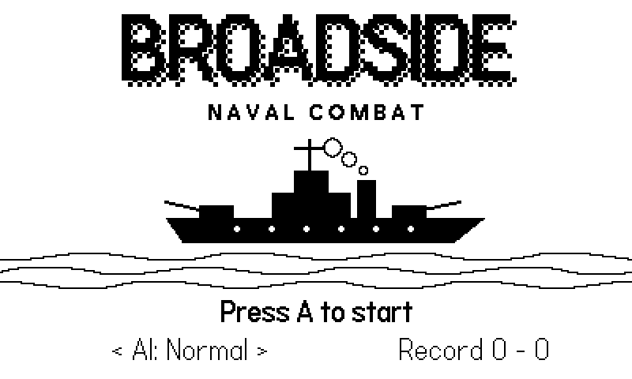
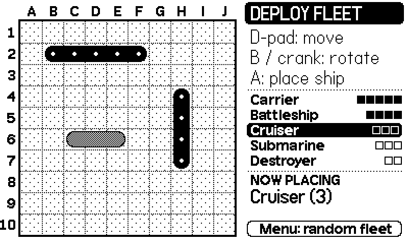
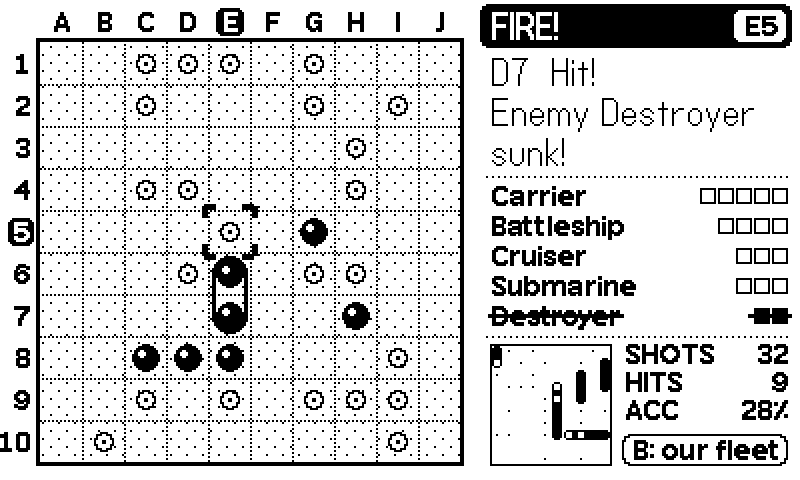
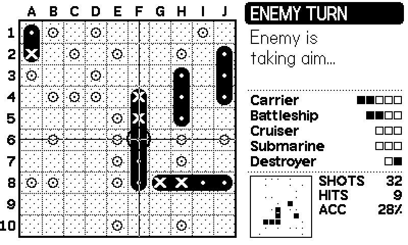
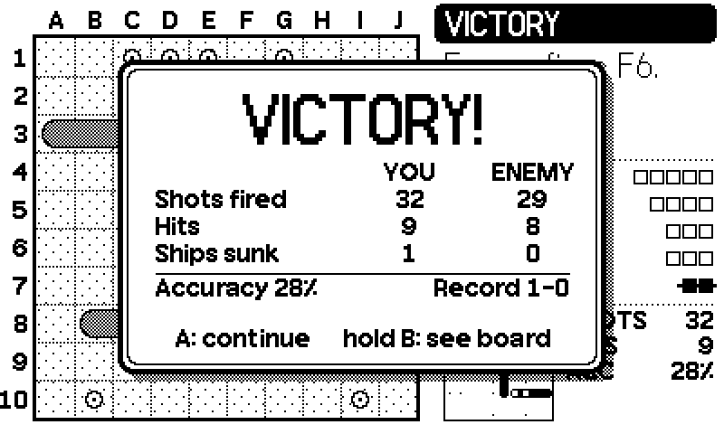

# Broadside

A grid naval combat game for the [Playdate](https://play.date) handheld.
Hide your fleet, hunt the enemy's. First to sink every ship wins.

Made by **BenTech2**. Open source under the MIT License: use it, change it, ship it, sell it, whatever you like.



| Deploy your fleet | Battle |
|---|---|
|  |  |
| **Enemy turn** | **Victory** |
|  |  |

## Install

1. Download `Broadside.pdx.zip` from the [latest release](../../releases/latest).
2. Sideload it at [play.date/account/sideload](https://play.date/account/sideload/). You can also put the console in Disk Mode and copy the unzipped `Broadside.pdx` into the `Games` folder.
3. To try it on a computer, open `Broadside.pdx` in the Playdate Simulator.

## How to play

**Deploying:** place your five ships on your 10×10 grid: Carrier (5), Battleship (4), Cruiser (3), Submarine (3) and Destroyer (2).

| Control | Action |
|---|---|
| D-pad | Move ship |
| B or crank | Rotate ship |
| A | Place ship |
| Menu → *random fleet* | Auto-place the rest of your fleet |

**Battle:** you and the computer take turns firing at each other's grid.

| Control | Action |
|---|---|
| D-pad | Move the target cursor |
| Crank | Sweep the cursor across the grid |
| A | Fire |
| Hold B | Peek at your own fleet |

Black pegs are hits and white rings are misses. Sink every enemy ship before they sink yours. Your win/loss record is saved.

**System menu:** *random fleet*, *new game*, and *AI* difficulty:
- **Easy:** fires mostly at random.
- **Normal:** searches in a checkerboard and hunts down hits.
- **Hard:** uses a probability map of where your ships could still be.

You can also change the difficulty with left/right on the title screen.

## Building from source

You need the [Playdate SDK](https://play.date/dev/). The build expects it at `~/Developer/PlaydateSDK`, or wherever `PLAYDATE_SDK_PATH` points.

```sh
./build.sh        # builds Broadside.pdx
./build.sh run    # builds and opens it in the Simulator
```

All the game code is in [`source/main.lua`](source/main.lua).

## Credits & license

- Game, code and art by BenTech2, released under the [MIT License](LICENSE).
- The small UI font (Roobert 10 Bold) belongs to Panic and comes with the Playdate SDK. It is not included in this repo or covered by the MIT License. `build.sh` copies it from your SDK when you build.
- Playdate is a trademark of Panic Inc. This project is not affiliated with or endorsed by Panic.
